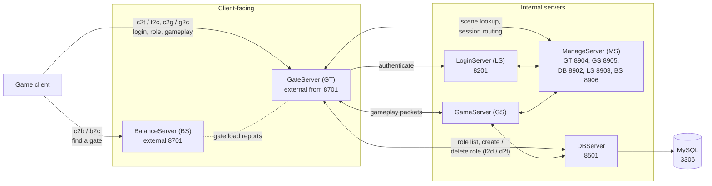
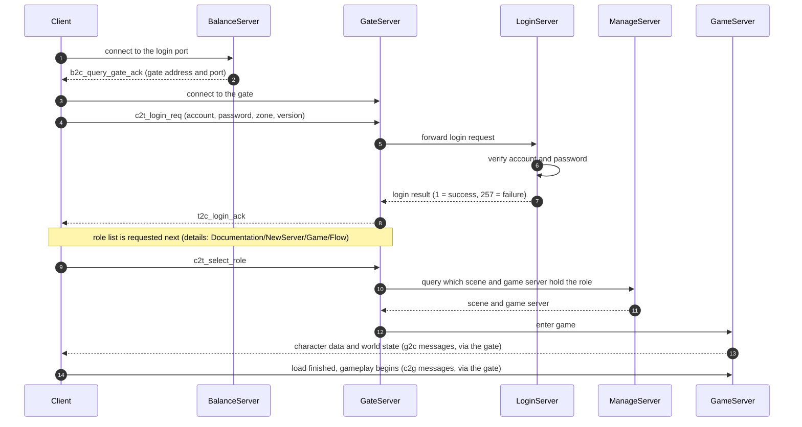
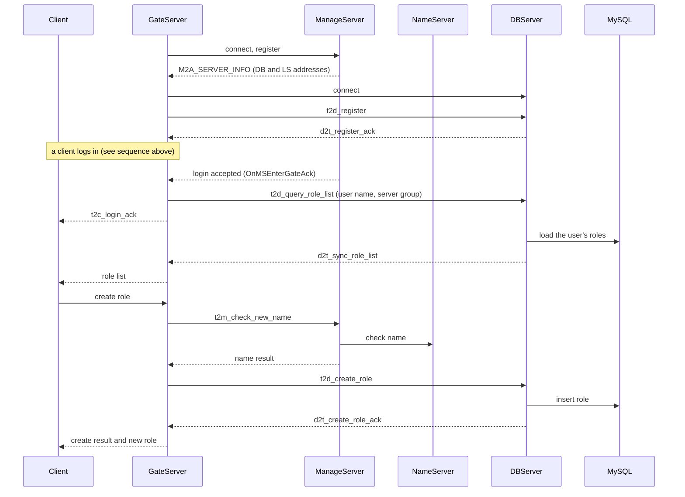

# Network architecture

How the client and the server processes talk to each other. The original design documents only have this as Visio (`.vsd`) files under `Documentation/NewServer/Game/Flow` and `Documentation/NewServer`, which GitHub cannot display. This page redraws the main picture as diagrams that render on GitHub.

Sources: the original flow notes (`Documentation/NewServer/Game/Flow`, `Documentation/Chuan Yongzhen Duan Doc/3-游戏功能流程`), the message headers in `Server/Common/message`, and the port settings in `Server/NewServer/bin/globalconfig`. Ports below are the repository defaults and can be changed in those config files.

## Server topology

Only the **Balance Server** and **Gate Server** accept client connections. Everything else is internal.

Notes:
- The Gate relays gameplay packets between the client and the Game Server and does the nine-grid (screen) broadcast for the Game Server.
- Message names follow `<source><destination>_<name>`: `c` client, `b` balance, `t` gate, `g` game, `m` manage. For example `c2t_login_req` is client to gate, and `t2c_login_ack` is the reply.
- Protocol definitions are in `Server/Common/message` (`c2t_message.h`, `t2c_message.h`, `b2c_message.h`, `c2g_message.h`, `g2c_message.h`, `c2m_message.h`, `m2c_message.h` and others). They are generated by `gen_msg`.
- The `ManageServer` ports are the repository defaults from `msconfig.lua`.
- The older 2011 design documents describe a similar layout with a separate Center Server and different default ports (BS 7001, GT 8701, LS 8201, Center 8601, DB 8501, GS 8401). This repository's server uses the ManageServer arrangement shown above.

## Login and enter-game sequence

Details and the function names behind each step are in `Documentation/Chuan Yongzhen Duan Doc/3-游戏功能流程` (`1-登录游戏.txt`, `3-进入游戏.txt`). The original Visio sequence diagrams for login, server hop and exit are `登录流程-V0.1.0.0.vsd`, `跳服流程-V0.1.0.0.vsd` and `退出流程-V0.1.0.0.vsd`.

## Gate ↔ DB relationship

The Gate talks to the DB Server for everything that concerns the **character list**: listing, creating, deleting and restoring roles. It does not load or save in-game role data; that is the Game Server's job (`g2d_load_lock_role_data`, `g2d_save_role_data`).

**Connection.** The Gate is the connecting side. When the Gate registers with the Manage Server, the Manage Server replies with the addresses of the DB and Login servers (`M2A_SERVER_INFO`, handled in `OnMSServerInfo`). The Gate then dials the DB Server (`gt_session_mgr.cpp`, "try to connect to DB"; it retries until connected and drops the link on ping timeout). On connect it sends `t2d_register` with its Gate session id and waits for `d2t_register_ack` before the Gate counts the DB as ready.

**Messages** (`Server/Common/message`, handlers in `gateserver/internal_message_handler.cpp` and `dbserver/db_message_handler.cpp`):

| Direction | Message | Purpose |
|---|---|---|
| GT → DB | `t2d_register` | Gate announces itself (Gate session id) |
| DB → GT | `d2t_register_ack` | Registration accepted |
| GT → DB | `t2d_query_role_list` | Ask for the roles of a user (server group + user name + client session id) |
| DB → GT | `d2t_sync_role_list` | Role count and the `ROLE_DB_BASE_DATA` of each role; the Gate forwards the list to the client and stores a copy in its client session |
| GT → DB | `t2d_create_role` | Create a role (id, name, sex, class, hair, face, skin) |
| DB → GT | `d2t_create_role_ack` | Result and the new role's base data |
| GT → DB | `t2d_delete_role` / `t2d_undelete_role` / `t2d_forever_delete_role` | Delete, restore, permanently delete |
| DB → GT | `d2t_delete_role_ack` / `d2t_undelete_role_ack` / `d2t_forever_delete_role_ack` | Results |
| DB → GT | `d2t_close_client_session` | DB asks the Gate to drop a client (the Gate marks the shutdown as DB-initiated) |

Messages carry the **client session id**, and the DB routes replies to the right Gate by taking the Gate index out of that id (`GET_GT_INDEX_FROM_SESSION_ID`). That is how several Gates can share one DB Server.

**When it happens in the login flow:**
1. After the Manage Server accepts the Gate's login (`OnMSEnterGateAck`), the Gate sends `t2d_query_role_list` and at the same time sends the client its login ack. The client session moves to `cssAuthed`.
2. `d2t_sync_role_list` arrives and the session moves to `cssRoleOperating`, where the client can create, delete or select a role. Create goes through the Name Server first (`t2m_check_new_name`) and only then `t2d_create_role`.
3. Selecting a role does **not** go to the DB: the Gate asks the Manage Server which scene and Game Server hold the role (`t2m_query_scene`) and then tells that Game Server to let the role in.
4. Returning to the role list from the game (Manage Server `m2t_return_select_role`) sends another `t2d_query_role_list`.

(The Name Server step is shown as it is handled in the Gate; the exact Manage Server to Name Server hop was not traced.)

## Ports

Defaults from `Server/NewServer/bin/globalconfig/*.lua`. Change them there. "Listens" means the process accepts connections on that port.

| Port | Server | Config | Who connects |
|---|---|---|---|
| 8701 | BalanceServer, external | `bsconfig.lua` `dwExternalPort` | Game client (first connection, to find a gate) |
| 8301 | BalanceServer, internal | `bsconfig.lua` `dwInternalPort` | Gate servers (load reports) |
| 8701+ | GateServer, external (start port) | `gtconfig.lua` `dwStartExternalPort` | Game client |
| 8401+ | GateServer, internal (start port) | `gtconfig.lua` `dwStartInternalPort` | Game servers |
| 8201 | LoginServer | `lsconfig.lua` `dwPort` | Gate servers |
| 8501 | DBServer | `dbconfig.lua` `dwPort` | Gate and Game servers |
| 3306 | MySQL | `dbconfig.lua` `dwDBPort` (also `nsconfig.lua`, `dlconfig.lua`) | DBServer, NameServer, DataLog |
| 8909 | NameServer | `nsconfig.lua` `dwPort` | ManageServer |
| 8801 | DataLogServer | `dlconfig.lua` `dwPort` | ManageServer and others |
| 8111 | CertServer | `commonconfig.lua` `dwCSPort` | Servers (license / certificate check) |
| 8810 | GuardServer | `commonconfig.lua` `dwGuardPort` | Servers (process supervision) |
| 8904 | ManageServer ← Gate | `msconfig.lua` `dwGTPort` | Gate servers |
| 8905 | ManageServer ← Game | `msconfig.lua` `dwGSPort` | Game servers |
| 8902 | ManageServer ← DB | `msconfig.lua` `dwDBPort` | DBServer |
| 8903 | ManageServer ← Login | `msconfig.lua` `dwLSPort` | LoginServer |
| 8906 | ManageServer ← Balance | `msconfig.lua` `dwBSPort` | BalanceServer |
| 8908 | ManageServer ← DataLog | `msconfig.lua` `dwDLPort` | DataLogServer |
| 8910 | ManageServer ← mobile/other | `msconfig.lua` `dwMMPort` | (comment in config: name server takes 8909) |
| 9010 | ManageServer ← GM | `msconfig.lua` `dwGMPort` | GM server |
| 9701 / 9702 | ManageServer ← LC / Gpk | `msconfig.lua` `dwLCPort`, `dwGpkPort` | Auxiliary servers |
| 8991 | ManageServer, online role count | `msconfig.lua` `dwOnlineRoleNumPort` | Monitoring |

Notes:
- The port numbers come straight from the config files. The "Who connects" column is inferred from the config and server names, except for Gate to DB, Gate to Login, Gate to Manage (verified in `gt_session_mgr.cpp`) and the client to Balance/Gate path.
- The Manage Server has one listening port per peer type (the `ManageServer ←` rows).
- The Balance Server and the first Gate share 8701 in the default config. Run them on different machines or change one port. With several Gates the start port is used as the first and later Gates take the following ports.
- `asimovconfig.lua` also sets 8904, which is the same as the Manage Server's Gate port; the Asimov tool is not covered here.
- The client does not choose these ports: the launch command carries the balance server address (`-ip=1,1,<ip>,<port>,<ip>,<port>,Legend`), and the Gate address is returned in `b2c_query_gate_ack`.
- Dedicated tools (`gmserver`, `mobileserver`, `mgateserver`) have their own settings. `mgconfig.lua` uses the same start ports as `gtconfig.lua`.

## Gate network threading

The Gate uses an IOCP network layer with one pair of roles:
- **IOCP worker threads** only move data: they complete receives and sends and re-post the next receive.
- **The main thread** runs the game logic: `CNet::MainLoop()` parses complete messages from the receive ring buffer and calls the message handlers. It never blocks on I/O.
- The two sides share a ring buffer without locks: the worker thread advances the tail, the main thread advances the head.

The full walkthrough (accept, receive, send, timeline) is in `Documentation/Chuan Yongzhen Duan Doc/99_网络协议封包/网络连接-完整逻辑.txt`.
