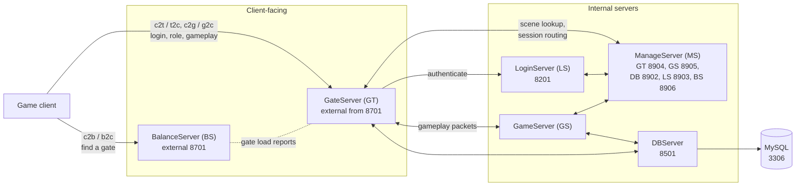
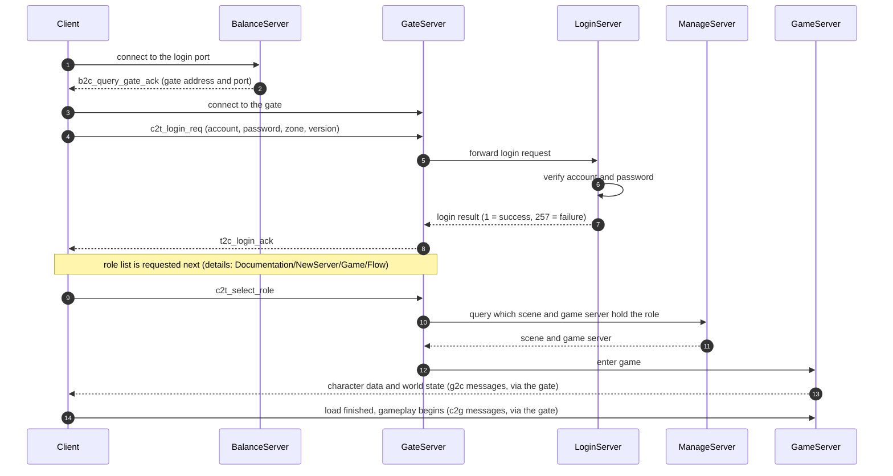

# Network architecture

How the client and the server processes talk to each other. The original design documents only have this as Visio (`.vsd`) files under `Documentation/NewServer/Game/Flow` and `Documentation/NewServer`, which GitHub cannot display. This page redraws the main picture as diagrams that render on GitHub.

Sources: the original flow notes (`Documentation/NewServer/Game/Flow`, `Documentation/Chuan Yongzhen Duan Doc/3-游戏功能流程`), the message headers in `Server/Common/message`, and the port settings in `Server/NewServer/bin/globalconfig`. Ports below are the repository defaults and can be changed in those config files.

## Server topology

Only the **Balance Server** and **Gate Server** accept client connections. Everything else is internal.

Notes:
- The Gate relays gameplay packets between the client and the Game Server and does the nine-grid (screen) broadcast for the Game Server.
- Message names follow `<source><destination>_<name>`: `c` client, `b` balance, `t` gate, `g` game, `m` manage. For example `c2t_login_req` is client to gate, and `t2c_login_ack` is the reply.
- Protocol definitions are in `Server/Common/message` (`c2t_message.h`, `t2c_message.h`, `b2c_message.h`, `c2g_message.h`, `g2c_message.h`, `c2m_message.h`, `m2c_message.h` and others). They are generated by `gen_msg`.
- The `ManageServer` ports are the repository defaults from `msconfig.lua`.
- The older 2011 design documents describe a similar layout with a separate Center Server and different default ports (BS 7001, GT 8701, LS 8201, Center 8601, DB 8501, GS 8401). This repository's server uses the ManageServer arrangement shown above.

## Login and enter-game sequence

Details and the function names behind each step are in `Documentation/Chuan Yongzhen Duan Doc/3-游戏功能流程` (`1-登录游戏.txt`, `3-进入游戏.txt`). The original Visio sequence diagrams for login, server hop and exit are `登录流程-V0.1.0.0.vsd`, `跳服流程-V0.1.0.0.vsd` and `退出流程-V0.1.0.0.vsd`.

## Gate network threading

The Gate uses an IOCP network layer with one pair of roles:
- **IOCP worker threads** only move data: they complete receives and sends and re-post the next receive.
- **The main thread** runs the game logic: `CNet::MainLoop()` parses complete messages from the receive ring buffer and calls the message handlers. It never blocks on I/O.
- The two sides share a ring buffer without locks: the worker thread advances the tail, the main thread advances the head.

The full walkthrough (accept, receive, send, timeline) is in `Documentation/Chuan Yongzhen Duan Doc/99_网络协议封包/网络连接-完整逻辑.txt`.
